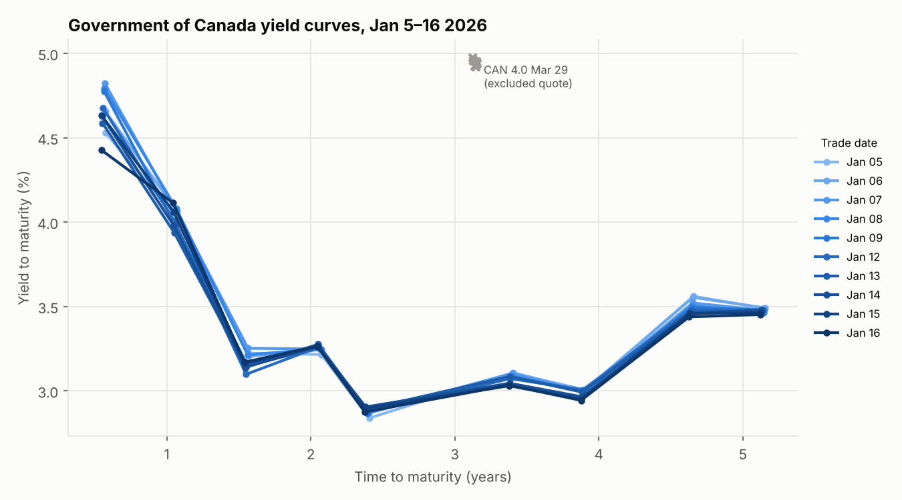
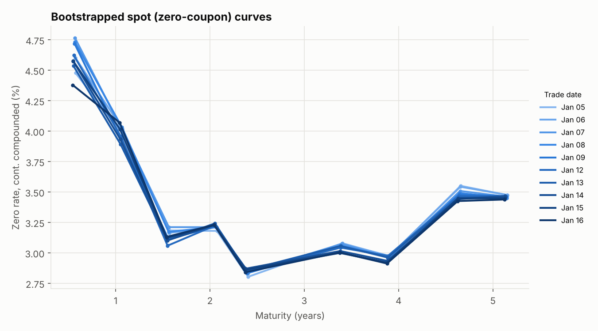
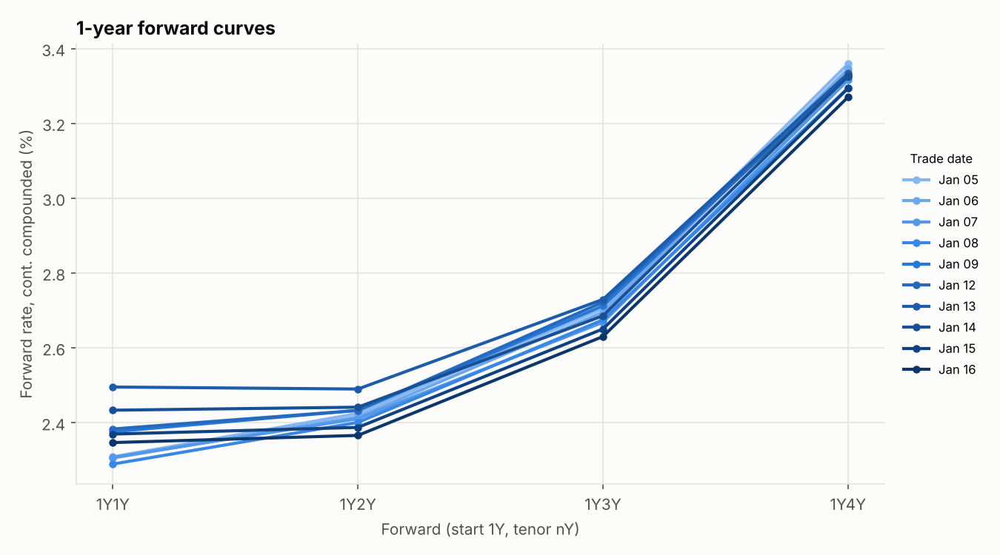
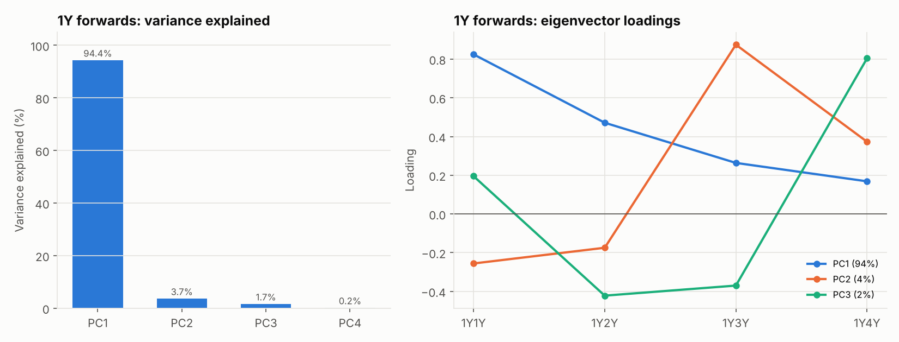
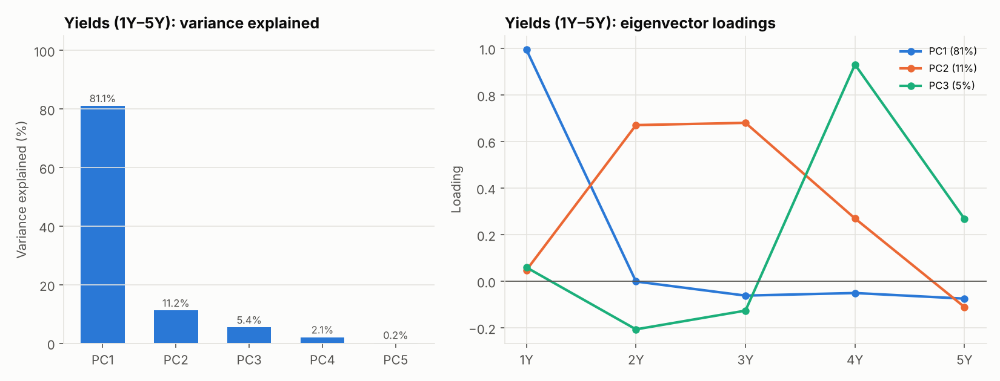

# Government of Canada Yield Curve Construction & PCA

[](https://github.com/XuxuZhou02/canada-yield-curve/actions/workflows/tests.yml)

A small, tested Python library and pipeline that takes daily clean-price quotes for
Government of Canada bonds and builds:

1. **Yield-to-maturity curves**, using dirty prices and fractional coupon periods
2. **Zero-coupon (spot) curves**, by sequential bootstrapping that reprices every bond exactly
3. **1-year forward curves** (1Y1Y–1Y4Y)
4. **Covariance matrices and principal components** of daily log changes in yields and forwards

It also adds an **automated quote-quality screen**. A robust Nelson–Siegel curve is fitted
each day, and any bond whose quote sits persistently far from it is excluded before
bootstrapping. On the sample data the screen catches a bad quote that would otherwise put a
200bp spike in the spot curve.

The data covers 10 benchmark-style GoC bonds (0.5–5.2 years to maturity) over 10 trading
days, **Jan 5–16, 2026**.

## Results

| Yield curves | Bootstrapped spot curves |
|---|---|
|  |  |



### Principal component analysis

| | PC1 | PC2 | PC3 | PC1–3 cumulative |
|---|---|---|---|---|
| Yields (1Y–5Y), log changes | 81.1% | 11.2% | 5.4% | 97.7% |
| 1Y forwards (1Y1Y–1Y4Y), log changes | 94.4% | 3.7% | 1.7% | 99.8% |




**What the results show**

- **The curve is inverted at the front and humped further out.** Short yields (~4.0–4.8%
  inside one year) are above the 2–4Y sector (~3.0%), and the curve rises again towards 5Y
  (~3.5%). Forwards slope upward, from ~2.3% (1Y1Y) to ~3.3% (1Y4Y), so the market
  expected short rates to fall and then recover.
- **Forwards: one factor drives most of the movement.** PC1 explains 94% of the variance,
  and all its loadings have the same sign, so it is a level shift. The loadings decay with
  tenor (0.82 → 0.17), so the shift is concentrated at the front of the forward curve.
- **Yields: PC1 is a front-end factor, not the textbook parallel shift.** It loads almost
  entirely on the 1Y point (0.99), which is the most volatile tenor in this window.
  PC2 is a 2–3Y "belly" move. The textbook level/slope/curvature split from
  Litterman–Scheinkman needs a much longer sample than 9 daily changes.

## Methodology

| Step | Implementation |
|---|---|
| Coupon schedule | Semi-annual dates generated by stepping back from maturity in whole 6-month periods (`bond.py`) |
| Accrued interest | ACT/365, the Government of Canada convention: `AI = c · F · days_since_last_coupon / 365` |
| Yield to maturity | Solve `P_dirty = Σ CF_k / (1 + y/2)^(2 t_k)` with Brent's method, where `t_k` is ACT/365 time to each cash flow (`yields.py`) |
| Quote screen | Daily Nelson–Siegel fit with a soft-L1 robust loss over a grid of decay parameters. A bond is excluded if its median absolute residual exceeds 75bp (`nelson_siegel.py`, `pipeline.py`) |
| Bootstrapping | Bonds are processed in maturity order. Zero rates are continuously compounded and linearly interpolated (flat at the ends). Coupons that fall *between* the last solved node and the new maturity depend on the unknown rate, so each node is found by a 1-D root search, not a closed-form formula (`curve.py`) |
| Forward rates | `f(t₁,t₂) = (r₂t₂ − r₁t₁)/(t₂ − t₁)`, with `t₁ = 1` and `t₂ = 2…5` |
| PCA | Covariance of daily log changes `ln(r_{t+1}/r_t)`, decomposed with `numpy.linalg.eigh`. Components are sorted by eigenvalue, and eigenvector signs are normalised so PC1 reads as an upward shift (`pca.py`) |

**Data-quality note.** CAN 4.0 Mar 29 is quoted at about 97.3. With a 4% coupon in a ~3%
yield environment, that implies a 4.9% yield, ~187bp off the fitted curve on every day.
Every other bond is within 30bp. The screen drops this bond and logs it
(`results/tables/nelson_siegel_residuals_bp.csv`).

## Project structure

```
├── data/
│   ├── bonds.csv               # ISIN, name, coupon, issue & maturity dates, issue size
│   └── clean_prices.csv        # daily clean prices, one column per ISIN
├── src/yieldcurve/
│   ├── bond.py                 # Bond: coupon schedule, accrued interest, cash flows
│   ├── yields.py               # YTM pricing and solver
│   ├── curve.py                # ZeroCurve, bootstrap(), forward rates
│   ├── nelson_siegel.py        # robust Nelson–Siegel fit
│   ├── pca.py                  # log returns, covariance PCA
│   ├── pipeline.py             # end-to-end analysis
│   ├── plotting.py             # figures
│   └── __main__.py             # command-line interface
├── tests/                      # pytest suite (pricing round-trips, bootstrap, PCA, screen)
├── results/
│   ├── figures/                # generated charts
│   └── tables/                 # generated CSVs (YTM, spot, forwards, covariances, PCA)
└── .github/workflows/tests.yml # CI
```

## Quick start

```bash
git clone https://github.com/XuxuZhou02/canada-yield-curve.git
cd canada-yield-curve
pip install -e ".[dev]"

pytest                       # run the test suite
python -m yieldcurve         # regenerate results/ (figures + tables)
python -m yieldcurve --help  # options, e.g. --outlier-bp 50, --out my_results
```

The library can also be used directly:

```python
from datetime import date
from yieldcurve import Bond, bootstrap, yield_to_maturity

bond = Bond("CA135087T388", "CAN 2.75 Sep 30", coupon=0.0275, maturity=date(2030, 9, 1))
yield_to_maturity(bond, clean_price=97.07, settle=date(2026, 1, 16))  # ≈ 0.0344
```

## Tests

The suite in `tests/` covers:

- **Price ↔ yield round-trips** and the par-bond identity
- **Bootstrapping:** a flat curve is recovered exactly; every input bond is repriced to
  1e-8; the result does not depend on input order; bonds with off-cycle coupon dates are handled
- **Forward-rate no-arbitrage consistency**
- **PCA:** a known level + slope covariance is recovered, and the eigenvectors are orthonormal
- **Robustness:** a single 200bp bad quote does not bend the Nelson–Siegel fit
- **End-to-end:** a regression test on the sample data

## Limitations and possible extensions

- **Short sample.** 10 days gives 9 daily changes, so the covariance estimates are noisy.
  The pipeline accepts a longer `clean_prices.csv` without code changes.
- **Interpolation.** Linear interpolation of zero rates gives kinked forwards. Monotone-convex
  interpolation or a Svensson fit would give smoother forward curves.
- **Settlement.** Settlement is assumed to be on the trade date. GoC bonds settle T+1, which
  changes accrued interest by about one day.
- **Prices.** Clean prices are end-of-day quotes from Markets Insider and are not executable prices.

## References

- Hull, J. C. (2021). *Options, Futures, and Other Derivatives* (11th ed.). Pearson.
- Litterman, R., & Scheinkman, J. (1991). Common factors affecting bond returns. *Journal of Fixed Income*, 1(1), 54–61.
- Nelson, C. R., & Siegel, A. F. (1987). Parsimonious modeling of yield curves. *Journal of Business*, 60(4), 473–489.
- Bank of Canada, [Government of Canada benchmark bond yields](https://www.bankofcanada.ca/rates/interest-rates/canadian-bonds/).
